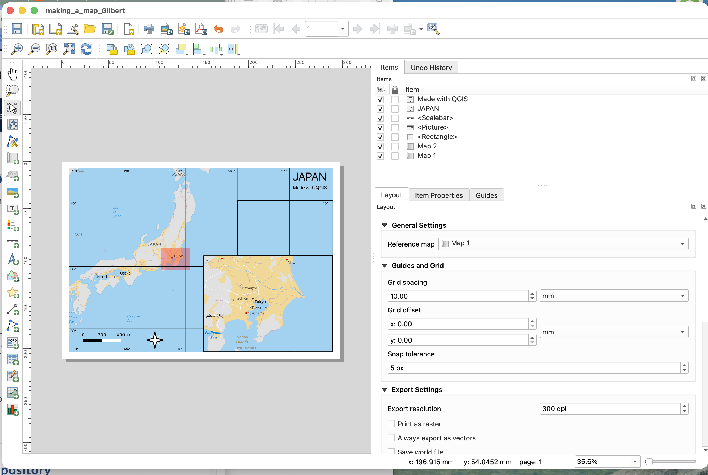
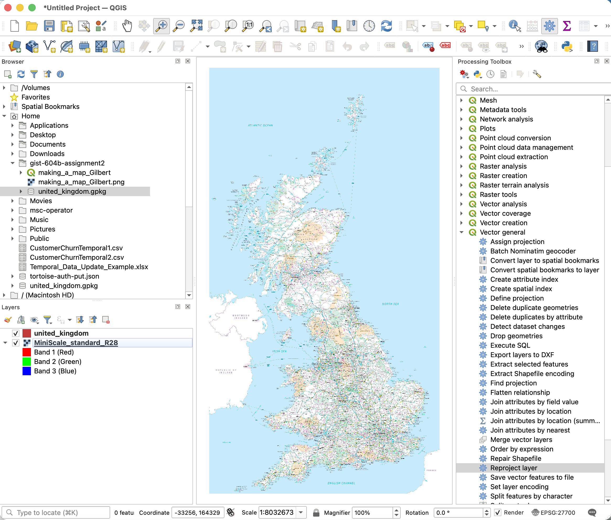
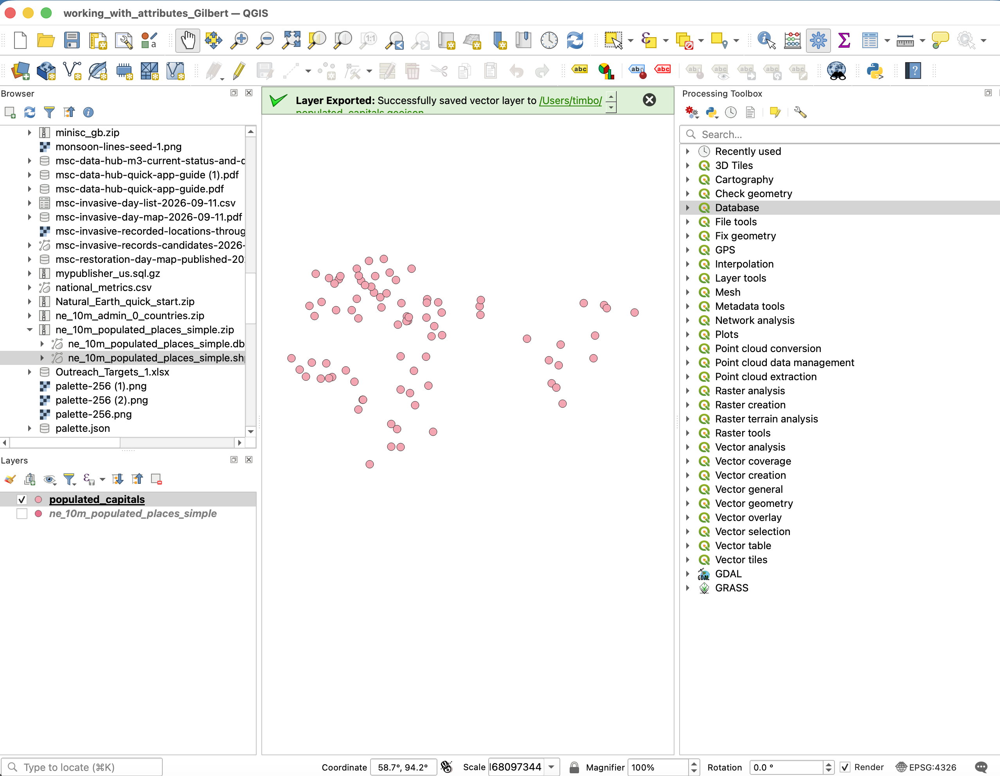
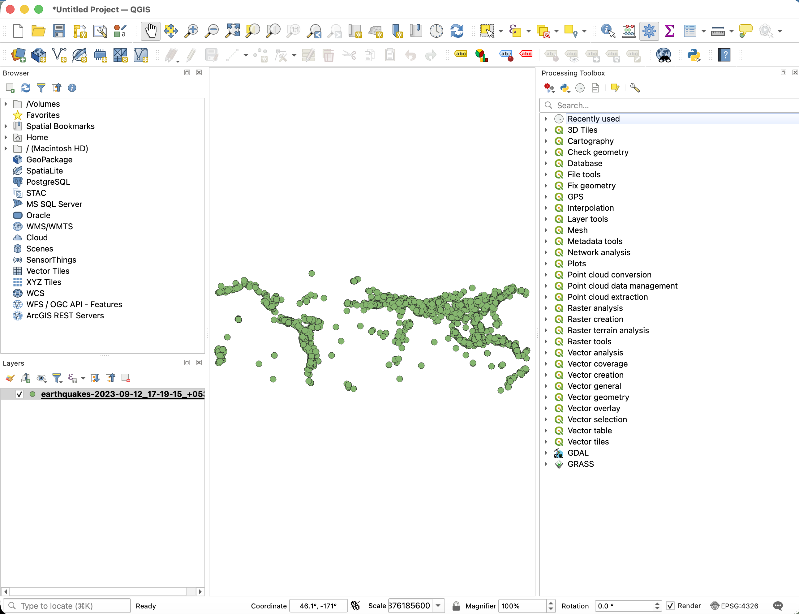
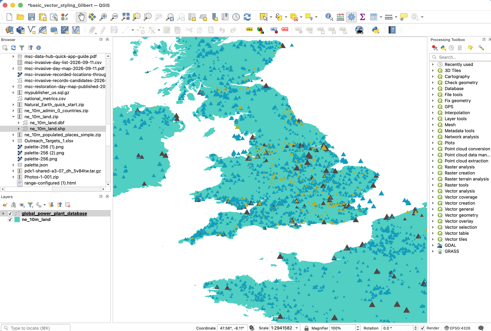
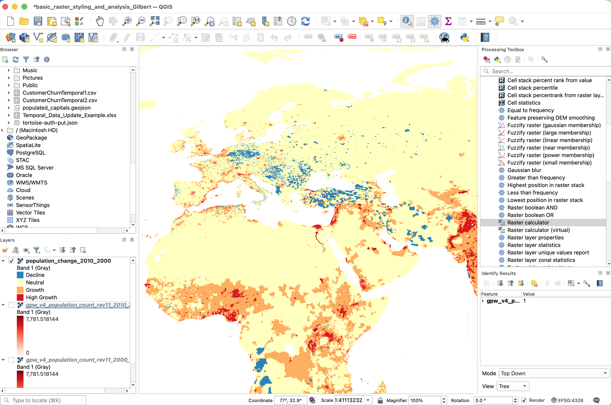
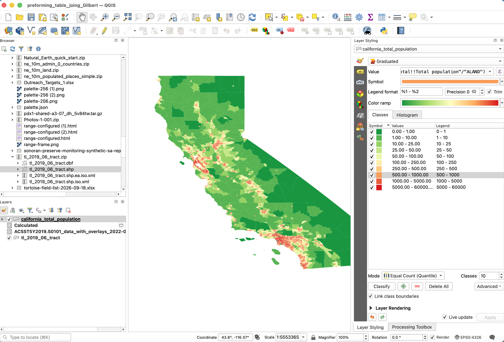
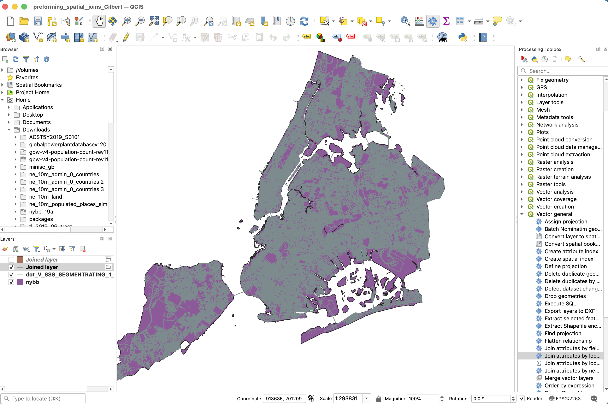
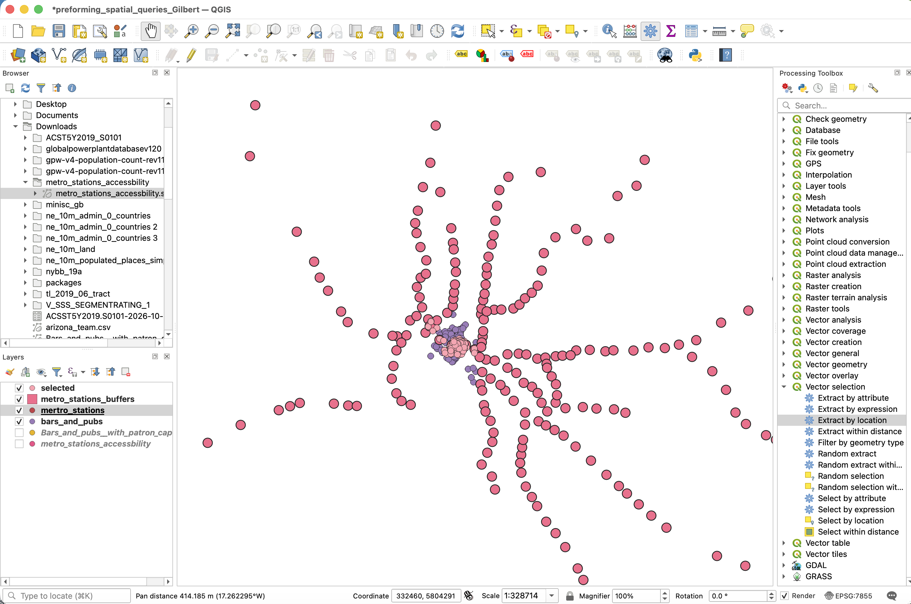
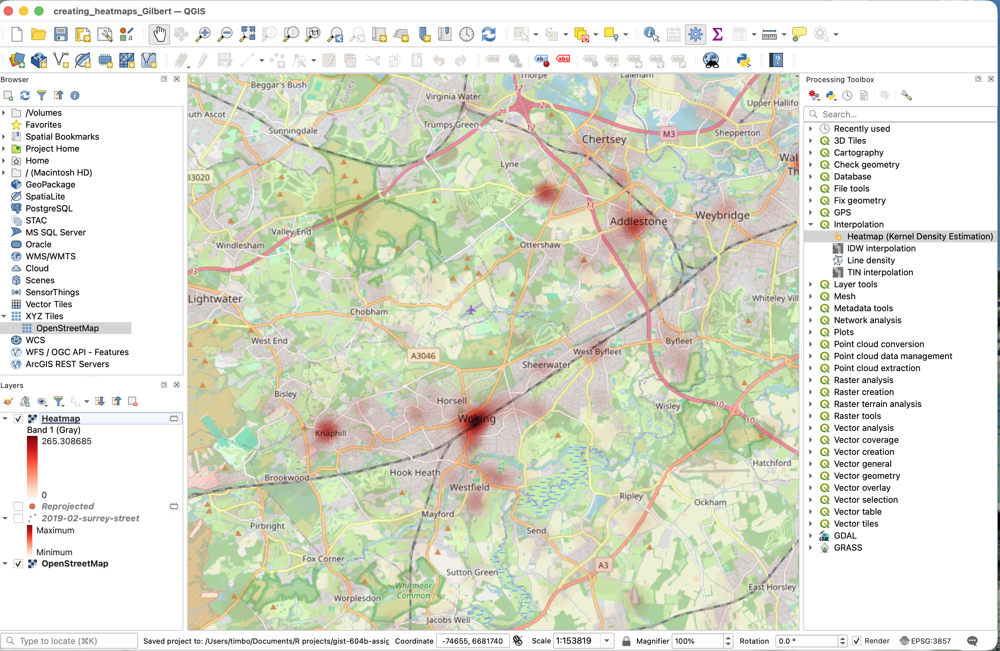

# gist-604b-assignment2

GIST 604B Assignment 2: QGIS Desktop GIS Projects

# Overview

This repository is for a University of Arizona course (GIST 604B) and contains QGIS projects and screenshots from ten desktop [QGIS tutorials](https://www.qgistutorials.com/en/index.html). Each project file is named after the tutorial it was created and stored in the '*projects'* folder. Each project has a matching screenshot from the project view with the Layers panel and map canvas visible. These are stored in the '*outputs*' folder.

**GIS skills practiced:**

- downloading and importing data

- creating new layers

- exploring and calculating new fields in attribute tables

- styling layers with categories and graduated colors

- Joining tables by shared field and location

- Selecting features with queries and by creating buffers

- making heat maps

# Software Environment

**QGIS Version Used:** QGIS 4.2

**Operating System:** MacOS

**Plugins used:** None. All tutorials were completed with core QGIS tools.

**Other tools:** VS Code and RStudio were used to write this README. Claude (an AI assistant) helped troubleshoot QGIS issues, such as reprojecting layers and saving multiple layers to a single GeoPackage, and helped with grammar and spelling.

# Completed Tutorials

1.  [**Making a Map**](https://www.qgistutorials.com/en/docs/3/making_a_map.html)

    

2.  [**Working with Projections**](https://www.qgistutorials.com/en/docs/3/working_with_projections.html)

    

3.  [**Working with Attributes**](https://www.qgistutorials.com/en/docs/3/working_with_attributes.html)

    

4.  [**Importing Spreadsheets or CSV files**](https://www.qgistutorials.com/en/docs/3/importing_spreadsheets_csv.html)

    

5.  [**Basic Vector Styling**](https://www.qgistutorials.com/en/docs/3/basic_vector_styling.html)

    

6.  [**Basic Raster Styling and Analysis**](https://www.qgistutorials.com/en/docs/3/raster_styling_and_analysis.html)

    

7.  [**Performing Table Joins**](https://www.qgistutorials.com/en/docs/3/performing_table_joins.html)

    

8.  [**Performing Spatial Joins**](https://www.qgistutorials.com/en/docs/3/performing_spatial_joins.html)

    

9.  [**Performing Spatial Queries**](https://www.qgistutorials.com/en/docs/3/performing_spatial_queries.html)

    

10. [**Creating Heat Maps**](https://www.qgistutorials.com/en/docs/3/creating_heatmaps.html)

    

# Skills Demonstrated

- Working with coordinate reference systems (CRS)

- Attribute table editing and joins

- Selecting data with queries

- Table joins and spatial joins

- Importing CSV data

- Styling vectors

- Styling rastors

- Saving and organizing data layers in a GeoPackage

- Creating heatmaps

- Troubleshooting errors in QGIS

# Reflection

As I worked through these projects, reprojecting became much clearer because I used it again and again. At first, I was super confused and didn't even know what it meant, so I just followed the directions without knowing why. By the third time, I started to notice the mini maps below the CRS options and realized each projection is built for a specific area, which is why I might need to change it based on where my data is located. It also helped that the tutorial data came from different parts of the world.

What was most challenging was learning the little things in QGIS. For example, I couldn't find a way to undo my last change, and I often changed a layer's style by accident when I used my scroll wheel without realizing my cursor was still over the styling menu. I plan on using these skills to make cool maps with ecological data and to find ways to combine them with my R Shiny app skills.
